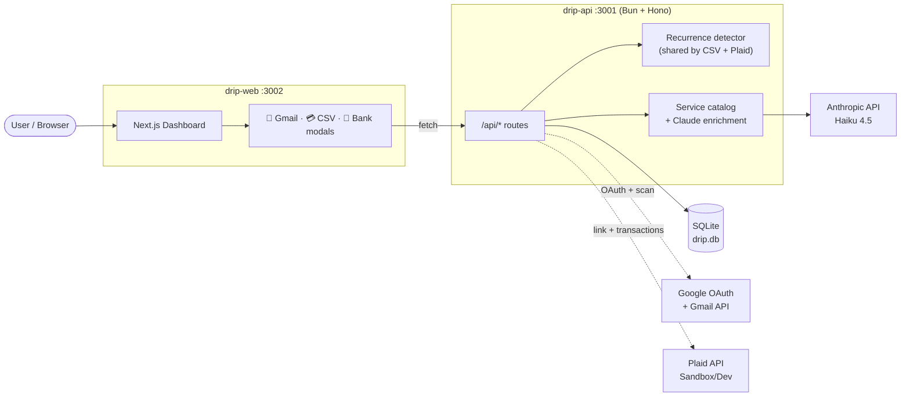
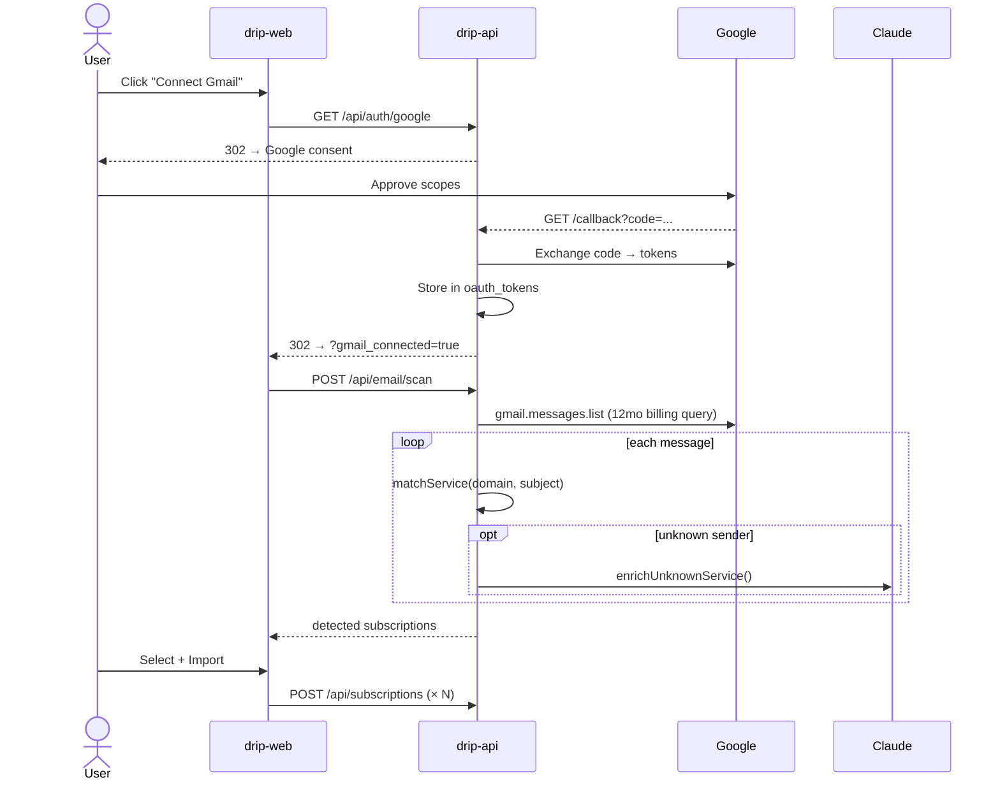
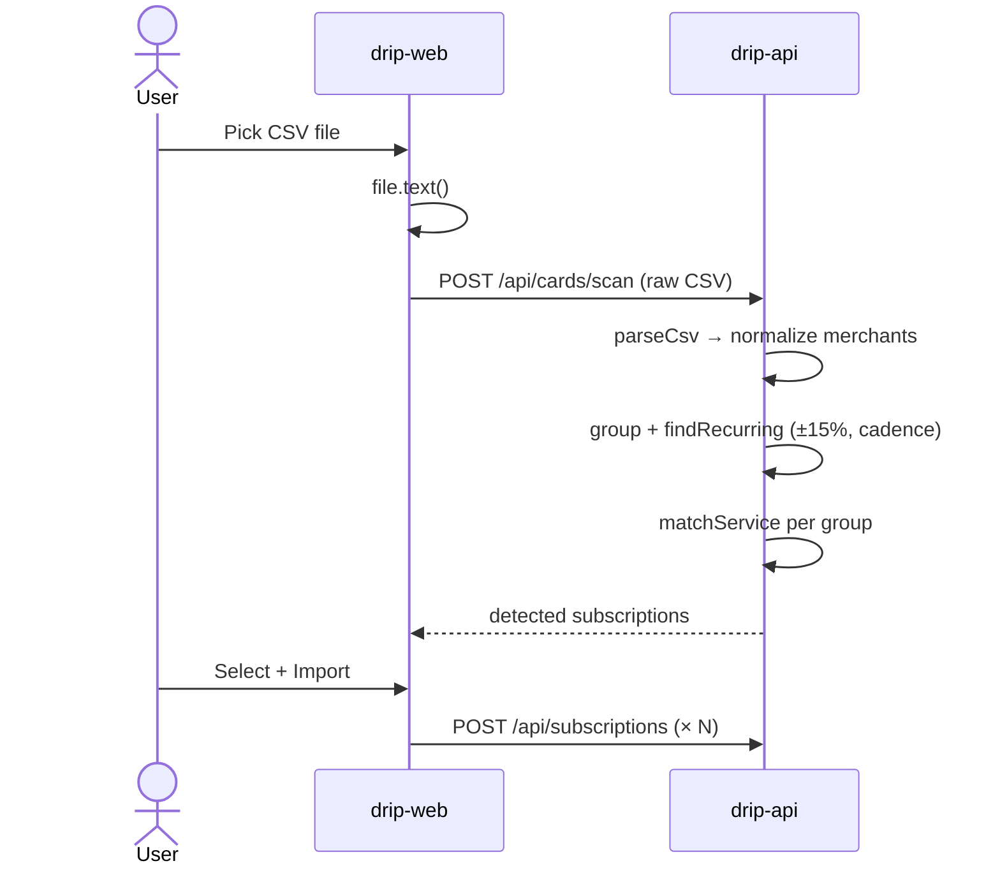
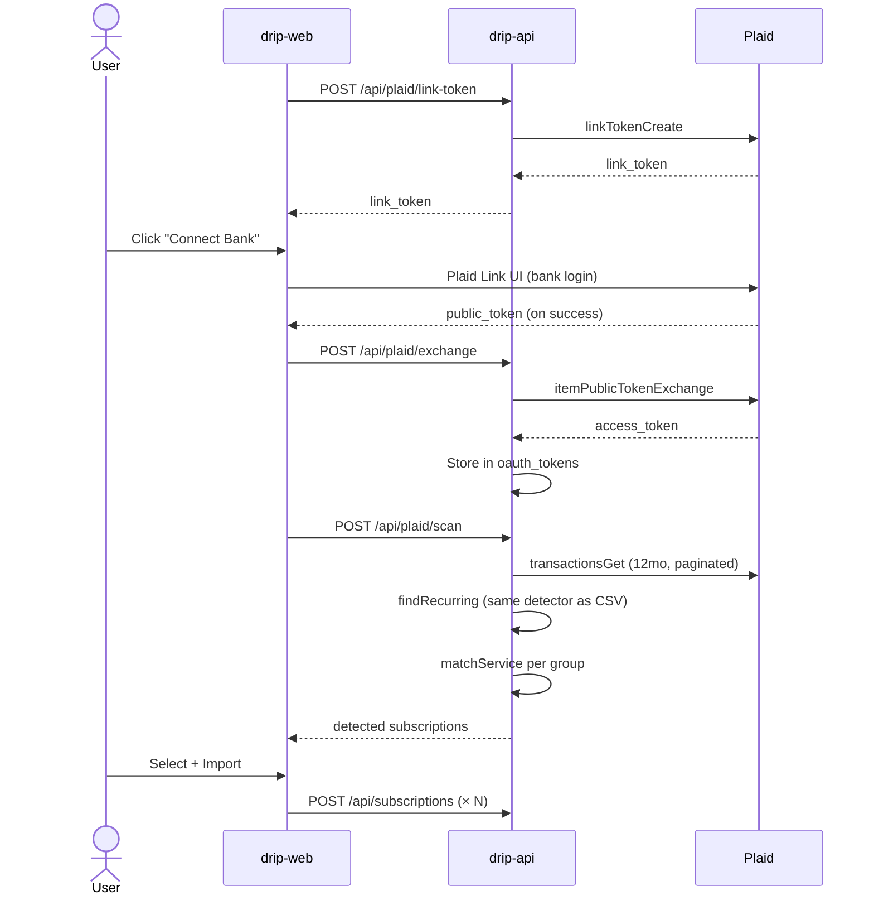

# Drip

Subscription tracker built for Canadians. Find what you're paying for via Gmail scan, CSV upload, or live bank link.

> **Public showcase repo** — architecture and design only. Source lives in a private repo.

## Stack

| Layer | Tech |
|-------|------|
| **drip-web** | Next.js 16 · React 19 · Tailwind CSS 4 · PWA (installable on iOS/Android) |
| **drip-api** | Bun · Hono · Drizzle ORM · SQLite |
| **Auth** | Google OAuth (Gmail), Plaid Link (banks) |
| **AI** | Claude Haiku 4.5 for unknown-service enrichment |

## Architecture

## Discovery flows

Three import paths, all funnel into the same review-and-import UI:

| Source | How it works | Confidence signal |
|--------|--------------|-------------------|
| **📧 Gmail** | OAuth read-only; scans last 12 months of billing emails; matches sender domain against a curated service catalog (Netflix, Spotify, Apple, etc.). Unknown senders go to Claude Haiku for one-shot identification. | `high` if catalog hit · `medium`/`low` if AI-enriched |
| **💳 CSV upload** | Drop a bank/credit-card statement (RBC, TD, Amex, Capital One, Scotia). Auto-detects column headers, normalizes merchant strings, groups by merchant, detects monthly/weekly/yearly cadence (±15% amount tolerance, ≥2 charges). | `high` if catalog hit · `medium` if 3+ occurrences |
| **🏦 Plaid** | Plaid Link → access token → 12mo transaction pull → same recurrence detector as CSV. Sandbox tier is free; major CA banks supported. | Same as CSV |

### 📧 Gmail

### 💳 CSV upload

### 🏦 Bank link (Plaid)

## Why I built this

Personal subscription sprawl is real. Existing trackers either want bank credentials I'd rather not hand over, or are manual-entry only. Drip lets you pick the comfort level:

- **Most private**: manual entry or CSV upload (no third party touches your data)
- **Most convenient**: Plaid bank link (read-only, no money movement)
- **In-between**: Gmail scan (read-only inbox access, billing keywords only)

## Author

[Nick Chung](https://github.com/NickChunglolz)
